---

### 👋 Bienvenido a ZACEK LABS

Ingeniería, informática y conocimiento de operación real. No solo programamos: entendemos cómo se mueve un negocio por dentro, y por eso construimos sistemas que la gente de verdad usa.

- 🚍 Plataformas de control operativo: diésel, kilometraje, llantas, mantenimiento y auditoría.
- 🛒 Tiendas en línea y menús digitales con pedidos por WhatsApp.
- 📊 Tableros de indicadores y reportes automáticos en Excel y PDF.
- ✨ Animaciones y experiencias 3D que hacen que tu página impresione.
- 🇲🇽 Trabajamos 100 % a distancia con negocios de todo el país.

### 💼 Proyectos

| Proyecto | Qué es | Tecnologías |
|---|---|---|
| **[ZACEK LABS](https://brockrodelas-ops.github.io/zacek-labs/)** | Sitio de servicios con animaciones 3D, consola interactiva, demos de tablero y ERP, y cotizador por WhatsApp. | HTML · CSS · JavaScript · GitHub Pages |
| **Plataforma de control de flota** | Sistema web para una empresa de transporte: diésel, kilometraje, llantas, mantenimiento y auditoría, con usuarios y permisos por área. | JavaScript · Supabase (PostgreSQL) |
| **Tienda en línea para ilustradora** | Catálogo de más de 30 productos con carrito, pedidos por correo, colecciones de temporada automáticas, carrusel 3D y tráiler animado. | JavaScript · Cloudflare Pages |

### 🛠️ Tecnologías

### 🚀 Cómo trabajamos

1. **Platicamos:** nos cuentas qué necesitas y entendemos cómo opera tu negocio.
2. **Diseño:** te enseñamos una vista previa antes de programar.
3. **Construcción:** programamos, probamos y te enseñamos avances en un link privado.
4. **Lanzamiento:** lo publicamos, te capacitamos y te damos soporte.

### 📫 Contacto

- 🌐 Sitio: https://brockrodelas-ops.github.io/zacek-labs/
- 💬 WhatsApp: desde el [sitio](https://brockrodelas-ops.github.io/zacek-labs/#contacto)
- ✉️ Correo: zacek_themiz@hotmail.com

<b>¿Tienes una idea? Hagámosla realidad.</b>

